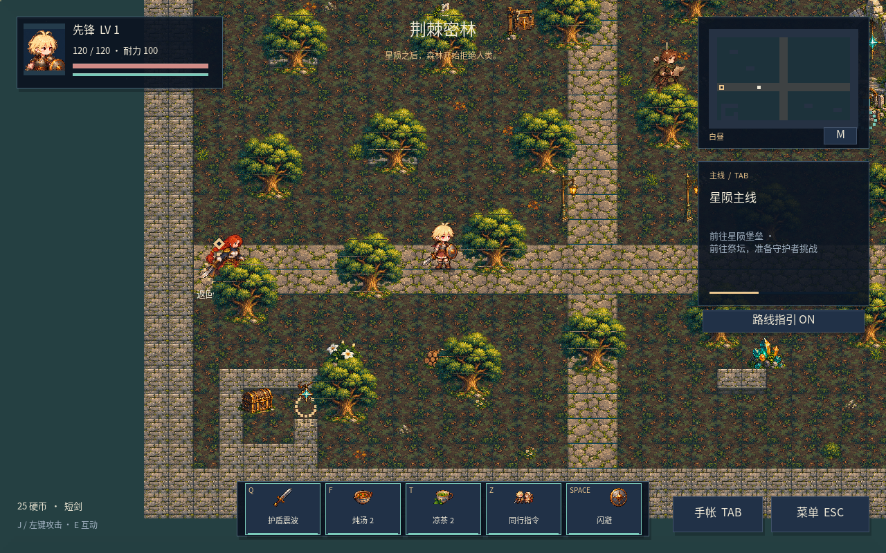
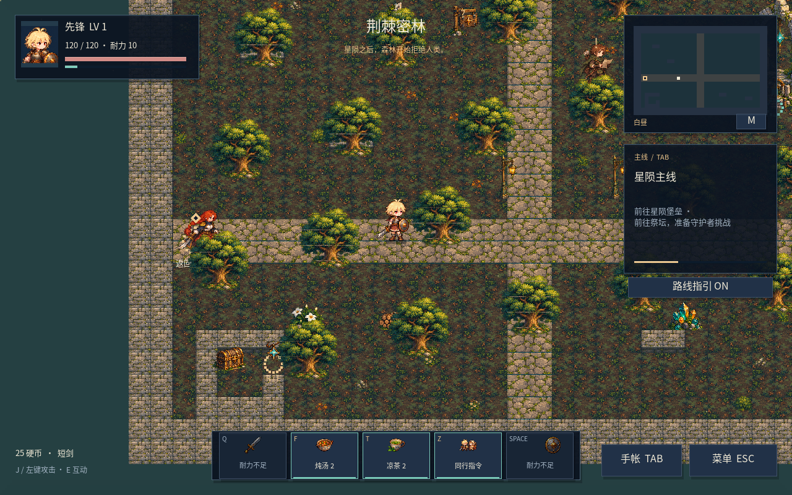
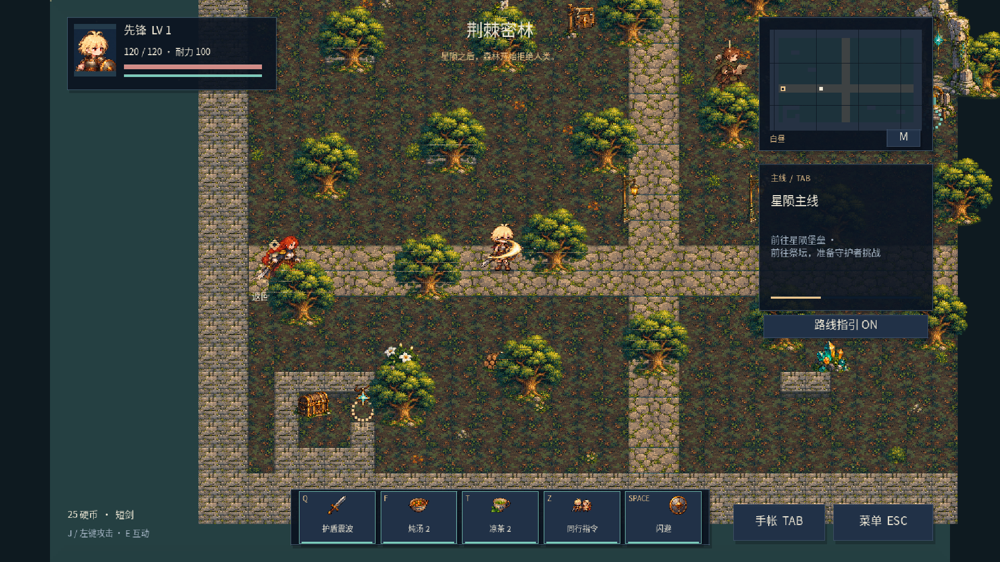

# 技能栏与战斗特效修复

本轮根据实际试玩截图检查生产绘制代码。未重绘角色或替换世界风格；沿用金发主角、现有职业与全部任务、存档、碰撞、数值和敌人AI。

| 问题 | 修复后的行为 |
|---|---|
| 技能已经冷却好，却被灰色块覆盖 | 不再继承 Unity 原生按钮皮肤的普通/高 DPI 背景。先绘制按钮，再绘制图标和文字；就绪时图标原色、青绿边框与底线 |
| 已冷却但耐力不足，看起来仍能使用 | 冷却、耐力不足、动作中分别显示倒计时或原因；可用条件与真实职业技能/闪避入口一致 |
| 旋转挥砍/飞行箭出现在地图远处 | 在1280×800逻辑画布内围绕效果中心旋转，再由窗口矩阵缩放和留边；方向改变不再改变中心位置 |
| 死亡、治疗或弓箭齐射出现职业爆发 | 死亡改为消散，米拉治疗改为治疗光，伊沃从本人位置放箭，森沿用实际冰霜中心。效果不再猜测当前主角职业 |
| 星火弹命中重复爆炸 | 只保留碰撞位置的一次魔法命中特效；弹体飞行、命中与原溅射伤害规则不变 |
| 范围显示小于实际伤害半径 | 主动战技、盾卫替代战技、冰霜和星火溅射使用原实际半径；范围圈仍是辅助信息 |
| 闪避拖尾始终朝同一方向 | 效果保存并读取真实闪避方向 |
| UI 绘制状态影响后续控件/其他界面 | 绘制后恢复先前的矩阵、颜色与可用状态；加载失败的提前返回路径也恢复。最小化到零尺寸时不再产生无穷坐标 |
| SPACE 文案与闪避图标拥挤 | 给完整键名留出空间，图标右移 |

`ProjectSettings/ProjectVersion.txt` 当前只有以下一行，不带 C1 或 revision：

```text
m_EditorVersion: 2022.3.53f1
```

升级时请一并覆盖这个文件，使用国际版 Unity 2022.3.53f1。如果已经能运行的国际版2022.3 LTS使用其他补丁号，该行填写它的真实编号。Unity打开工程后可能重新写入自身的版本元数据；本次交付文件确实只有一行。

## 验证证据与限制

此前离线桩把矩阵视为恒等矩阵、未绘制原生按钮背景，因此漏掉了用户实际碰到的两类问题。本轮补上真实二维仿射矩阵，以及普通/高 DPI 背景的模拟，不能将它们视为 Unity GPU 或完整 IMGUI 仿真。

- 28组实际生产Core回归全部通过。新增 `EffectOriginsAndSources` 检查三职业战技、替代战技、敌人死亡、三名同行者指令、真实弹体碰撞与闪避方向；原攻击接触、暂停、碰撞、奖励与存档检查继续通过。
- `RenderStateChecks` 执行生产绘制方法，检查7种窗口（1280×800、1920×1080、2560×1440、800×600、3840×2160、900×1600、3440×1440）×8个方向。特效中心误差小于0.035屏幕像素，箭头和拖尾方向、镜头/震动偏移、鼠标逆变换与GUI状态恢复通过。
- 1x/2x DPI模拟检查就绪、冷却、低耐力、攻击准备、闪避中、死亡、空消耗品和无同伴状态，以及可用按钮只施放一次、禁用按钮不花费资源。先复现继承皮肤后只清除普通背景仍会覆盖的错误，再验证生产控件没有继承任何背景。
- 1011个生产OnGUI记录没有检测到文字溢出；55张资源PNG、264个有效图格、142个唯一GUID及1206个所需字形检查通过。Editor/PlayMode源码离线语法编译通过。
- `GuiPresentationTests` 提供Unity原生矩阵与按钮皮肤检查，**本环境没有Unity Editor/Player，尚未执行**。原生GUIClip、字体渲染、实际DPI、音频、手柄、帧率及构建仍需实机复验。

以下图片和包内动图来自生产代码的离线记录，不是Unity实机截图。







## Unity 实机复验

覆盖更新后打开 `Assets/Scenes/Frontier.unity`。冷却结束且耐力充足时，Q/闪避应显示原色并可用；耗尽耐力时应显示原因。分别点击鼠标按钮与按快捷键，确认一次输入只消耗一次资源。

将Game View设为16:10、16:9、4:3与超宽比例，并拖动窗口大小。三个职业各向八个方向攻击、施放、闪避；箭矢从实际攻击者飞出，拖尾沿飞行路径，挥砍跟随锁定方向，命中反馈位于被击中者。再检查三名同伴指令、普通敌人死亡与Boss战，确认没有额外的主角职业爆发。

使用 `Starfall > Visual QA > Open Review Lab` 可在保护旅程存档的独立测试场逐帧检查。在Test Runner的PlayMode运行 `Starfall.VisualTests`（含 `GuiPresentationTests`）；图形检查保持Game View可见。原存档无需删除或重新开始。
