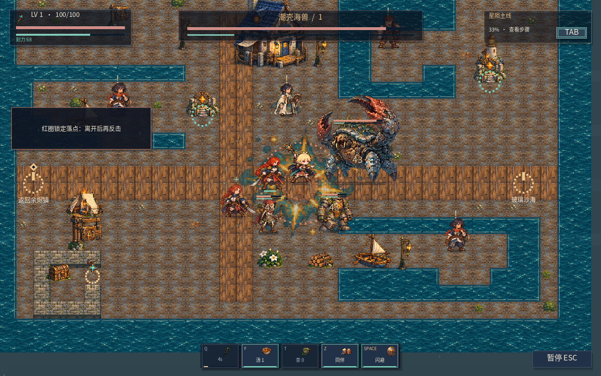

# 统一视觉与战斗表现升级

这轮以现有工程为基础，先检查资源、运行时绘制、角色身份与伤害入口，再替换视觉层。原 `ViolaMoves.png` 完整保留，奶油金短发、侧分额发、翘起发束、浅肤年轻圆脸是所有主角版本的依据。此前错误的三个职业肖像格不再用于主角。

## 已接入游戏

| 范围 | 实现 |
|---|---|
| 主角与职业 | 先锋、游侠、星术师共用同一身份；三个装备版本的头像、职业选择、HUD、背包预览与可操控小人对应。主武器更换会切换装备外观，强化增加武器符光；职业属性与 Q 仍沿用原职业 |
| 主角动作 | 每职业12个基本姿态，另补北向行走/攻击和南向攻击，共60个绘制姿态；准备、接触、战技、闪避、格挡、受击、倒地都由动作时钟驱动。剑的第三击与蓄势打法用更重的准备/释放姿态 |
| 普通敌人 | 软泥、持弓掠夺者、重甲矿卫各有独立结构及6个姿态；射手额外补上北/南向准备与释放，弓朝向和飞行箭方向一致；射手后撤、重甲正面护甲和破势规则保留 |
| Boss | 八套独立轮廓及待机、准备、释放、死亡姿态；枝角巨兽、潮壳巨蟹、齿轮监工、统领、潮壳海兽、琉璃守卫、霜钟执事、地脉收割者分别使用木质、甲壳、机械、金属、玻璃、冰霜、根系等材质 |
| 居民 | 16个统一比例的人物外观，通过衣服、发型、工具、盾牌、配饰区分公会、药师、铁匠、厨师、渔者、侦察员、教官、使者、同行者及旅客；现有角色功能和对话继续使用 |
| 同行者 | 米拉、伊沃、森各12个移动与支援姿态，共36格；保留原身份和效果，准备时双脚站稳，指令/自动支援分别在0.20/0.16秒释放；跟随位置检查原脚底碰撞，减少遮住主角 |
| 地面与环境 | 48像素逻辑地形密度，16种材料及草地/林地/石路/水面各4种变化；场景道具、室内家具、植被、碎石、骨骸、箱桶、残柱等统一到现有像素绘画方向 |
| 界面与特效 | 16个材质图标及16个战斗效果；保留统一深蓝、象牙白、米金、青绿的菜单规则，补上掉落收取与 Boss 结束提示 |
| 室内 | 在余烬镇旧旅店前添加入口；新增炉火旅店，提供休息、料理、房间家具、旅客与赊账簿记录，不改变原九区道路 |

完整标准见 [ART-BIBLE.md](ART-BIBLE.md)，逐格纠错见 [POSE-QUALITY-REVIEW.md](POSE-QUALITY-REVIEW.md)，导入格尺寸、源图与锚点见 [ATLAS-IMPORT.json](ATLAS-IMPORT.json)。原始绘制图保存在 `Assets/ArtSource/Frontier`，运行图在 `Assets/Resources/Frontier/Art`。源图不放进 Resources；导入工具只切格、分离相邻格、统一技术尺寸和脚底锚点，不绘制素材。主角/同伴采用192像素画布，Boss采用320像素画布，给伸展武器和身体留足空间，保持角色实际比例。

## 动作和伤害使用同一时间轴

输入先启动准备动作，伤害或飞行物只在接触/释放边界发生。剑在原武器间隔的45%处挥击；弓在55%处发射；法杖在45%处释放；Q先准备0.28秒。判定读取动作锁定方向，与北/南/左右的动作版本对应。受击会暂缓尚未释放的准备，避免受击姿态遮住一次不可见的伤害。

菜单暂停冻结动作和判定。换武器、换打法/战技及旅行取消尚未释放的动作。箭、星火与敌方弹体继续用原真实飞行、碰撞和伤害规则，增加手部高度、方向、拖尾、命中与消失表现。范围预警位于人物下层，身体准备、释放与命中效果分别表现攻击来源和落点。

命中采用短暂白闪、受击姿态与可视后退，按攻击强度加入约25–50毫秒的停顿和短震动。后退是视觉偏移，没有新增穿墙的物理推挤。减少动态选项关闭停顿/震动与环境晃动，仍保留动作和关键信息。新增准备、重砸、箭矢和法术音色；实际听感尚需 Unity 验收。

敌人死亡立即退出战斗并按原规则结算一次，但尸体继续显示约0.65秒；Boss约1.4秒并有消散、掉落图标和结束反馈。玩家倒下0.9秒后再恢复回镇。死亡途中存档带有恢复标记，重进安全回镇，不重复收取惩罚。

## 保留与必要修复

原九区的行列、装饰、出生点和全部旧对象逐项与基准提交比较一致，仅在镇中追加旅店门。Boss/物品数据、原记录、任务、数值、掉落、存档产品路径与既有职业玩法保留。仍使用 Built-In + IMGUI，未改用 URP、物理光照或另一套战斗框架。

必要行为调整是延后至动作接触帧、受击时暂缓准备、死亡恢复延后，以及让密林巨兽的原冲锋路径在前摇末段真实移动。寻路检查整条直线而非只看第一步，修复地脉走廊中敌人反复顶墙的问题。本轮另修复快速闪避跳过薄墙，以及普通挥剑/软泥扑击隔墙命中；使用原碰撞范围和小步检查，不更换地图布局或角色碰撞盒。技能范围、伤害、生命、奖励和同伴原效果保留。

场景检查还修复了遮挡问题：镜头按 HUD 之间的可操作区域跟随；同深度时主角优先显示；主角在巨型 Boss、NPC或同伴后方时降低遮挡，并在近敌时收起交互大面板。大范围效果在人物下方，前景树与遗迹在人物附近淡化。冻结的测试场也用实际脚底范围摆放人物，不能为了拍照把主角或同伴放进水里。

## 已验证 / 未验证

- 28组生产 C# 核心回归通过，包括三职业原主线、远岸方案、六层地脉、攻击时序、飞行物、死亡途中恢复、室内进出、家具碰撞、隔墙攻击/快速闪避、同伴准备/释放/暂停/旅行取消、特效来源与旧存档。
- 生产 OnGUI 的1011个离线记录状态没有检测到文字溢出：三职业、四方向、三名同伴、竖向射手、十张地图、八个 Boss 的实际 AI 前摇/释放/死亡时间线、菜单焦点与测试场存档隔离。另加入7种窗口尺寸×8个攻击方向的真实二维矩阵检查与1x/2x DPI按钮皮肤模拟，详见 [GUI-EFFECTS-BUGFIX.md](GUI-EFFECTS-BUGFIX.md)。
- 中英文、两种字级与键盘/手柄提示的布局检查见 [QA-REPORT.json](QA-REPORT.json)。PNG、角色白闪所需导入设置、GUID 与字体字形检查通过。
- Editor 工具和 PlayMode 测试源代码通过离线语法编译；这不能证明 Unity API、GPU、原生字体或平台构建正确。
- 本环境没有 Unity Editor/Player，**未完成原生试玩、GPU效果、真实手柄、音频试听和帧率验收**。`docs/previews` 和下方动图均为离线场景预览，不能当成 Unity 实机录屏。

## Unity 内的验收入口

关闭 Unity 后覆盖工程更新，本轮也更新 `ProjectSettings/ProjectVersion.txt` 为单行国际版 `2022.3.53f1`；其他已能运行的国际版2022.3 LTS补丁号填写真实编号。播放 `Assets/Scenes/Frontier.unity`。

`Starfall > Visual QA > Open Review Lab` 可以选职业、区域和 Boss，进入独立测试旅程。冻结后逐帧检查，也可解除冻结在 Game View 实战。测试场拦截自动/手动存档；退出恢复原 GameCore 对象。截图按钮切到 Game View，在帧末输出 `docs/native-captures`。

在 `Window > General > Test Runner` 运行 EditMode 的 `Starfall.Tests`，再运行 PlayMode 的 `Starfall.VisualTests`。PlayMode 检查导入、各场景与接触时序、八个 Boss 的前摇/命中/死亡，并保存原生截图。需要有图形输出且保持 Game View 可见；不要用 `-nographics` 做截图验收。

最后实际进行一次新游戏到阶段结尾、退出重进、换装备、死亡恢复，并在草地、城镇、遗迹、矿场、旅店和 Boss 战检查轮廓、前摇、碰撞、命中、遮挡、声音与帧率。此步骤尚未在本环境执行。
